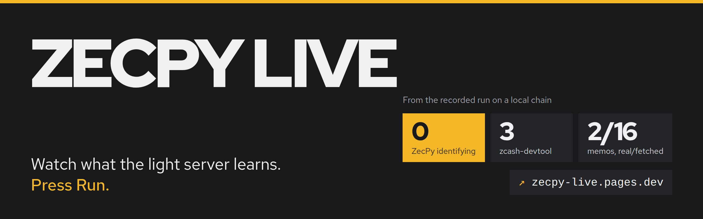
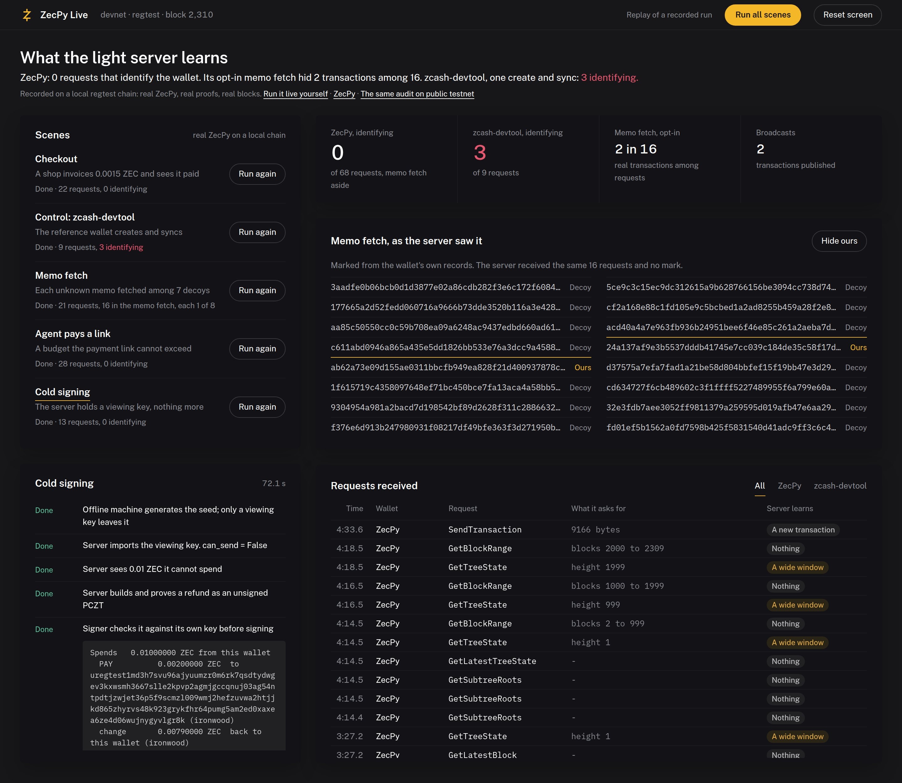

<p align="center">
  <a href="https://zecpy-live.pages.dev"></a>
</p>

<p align="center">
  <a href="https://zecpy-live.pages.dev"></a>
  <a href="https://pypi.org/project/zecpy/"></a>
  <a href="#license"></a>
</p>

<p align="center">
  <a href="https://zecpy-live.pages.dev"><b>Open ZecPy Live</b></a> ·
  <a href="https://github.com/mikemoulder/zecpy">ZecPy SDK</a> ·
  <a href="https://zecpy.pages.dev">Website and docs</a> ·
  <a href="https://github.com/mikemoulder/zecpy/blob/main/docs/privacy-report.md">Privacy report</a> ·
  <a href="https://github.com/mikemoulder/zecpy/blob/main/docs/testnet-run.md">Testnet run</a>
</p>

---

**ZecPy Live shows the one thing a privacy claim usually hides: what the server actually
sees.** It runs [ZecPy](https://github.com/mikemoulder/zecpy), a Python SDK for shielded
Zcash, through five real scenarios, and beside them prints every request the light server
receives, the moment it arrives, labelled by what it gives away.

**Open it now: [zecpy-live.pages.dev](https://zecpy-live.pages.dev).** Press **Run** on a
scene, or **Run all scenes**, and watch a recorded run replay with its original timing. Or
run every scene live, on your own machine, against a local Zcash chain.

<p align="center">
  <a href="https://zecpy-live.pages.dev"></a>
</p>

## Why it exists

Shielded Zcash hides payments on chain, but a wallet still has to ask a light server for
data, and the questions can identify it. "Private" is easy to write in a README and hard to
check. ZecPy Live makes it visible: two recording proxies sit between the wallets and the
server, and every request appears on screen with a plain answer to one question, **what
did the server just learn?**

| Label | Means |
|---|---|
| **Nothing** | Every wallet makes this request; it says nothing about this one |
| **A wide window** | Reveals something, only within a deliberately wide range (a 1,000-block boundary) |
| **A new transaction** | Publishes a transaction; unavoidable when sending, and shielded |
| **1 of 8, hidden** | ZecPy's opt-in memo fetch: one real transaction among seven decoys |
| **Who you are** | Ties the request to this wallet's addresses, transactions or history |

## The five scenes

| Scene | What runs | What the server learns |
|---|---|---|
| **Checkout** | A shop wallet issues an invoice; a customer pays it; the payment confirms | Nothing identifying: compact blocks, aligned tree states, one broadcast |
| **Control: zcash-devtool** | The reference wallet on the same librustzcash crates creates and syncs, through its own proxy | Its exact birthday and its transparent addresses: **3 identifying requests** |
| **Memo fetch** | Nine payments land in one block; `fetch_memos()` reads the shop's memos | Each real transaction requested among 7 decoys. **Reveal ours** marks which were real, on your screen only |
| **Agent pays a link** | An agent reads a ZIP-321 link; `pay(max_zat=100_000)` is refused, `max_zat=200_000` pays | One broadcast; the invoice confirms on the shop's side |
| **Cold signing** | A watch-only server builds and proves a PCZT; an offline signer inspects and signs it | One broadcast; the server never held a spending key |

All of it is real ZecPy, real proofs and real blocks. Nothing on the page is mocked: the
hosted copy replays [`demo/static/replay.json`](demo/static/replay.json), a recorded run of
these same scenes.

## Two ways to use it

| | Hosted replay | Live, on your machine |
|---|---|---|
| **Where** | [zecpy-live.pages.dev](https://zecpy-live.pages.dev) | `http://127.0.0.1:8077` |
| **What Run does** | Replays that scene from the recording, with its original timing | Runs real ZecPy against a local chain: proving, signing, mining |
| **Needs** | A browser | The ZecPy repo, its devnet, Python 3.10+ |

### Run it live

The live page needs the [ZecPy SDK](https://github.com/mikemoulder/zecpy) checked out next to
this repo (`../zec`, or set `ZEC_REPO`) with its devnet running. The devnet README lists the
binaries (zebrad 7.0.0, lightwalletd 0.6.0).

```bash
git clone https://github.com/mikemoulder/zecpy ../zec
cd ../zec && uv venv .venv && . .venv/bin/activate && uv pip install -e '.[dev,examples]'
devnet/up.sh <a uregtest1... address for block rewards> && cd -
uvicorn demo.server:app --port 8077
```

Open http://127.0.0.1:8077 and press **Run** on a scene. **Reset screen** clears the page
between takes; the wallets made so far stay in `runs/`.

Locally, `?replay` plays the recording without a chain, `?replay=instant` shows it all at
once, and `&reveal` turns the memo toggle on. Re-record with `python -m scripts.record`.

## How it works

```text
browser   index.html + app.js: renders the event stream
   │  live:   EventSource /events  ◄─ every step and every audited request
   │  hosted: replay.json, played back when Run is pressed
   ▼
demo/server.py    FastAPI: runs the scenes (demo/scenes.py) with real ZecPy wallets
   │
   ▼
two leak-audit proxies (ZecPy's and zcash-devtool's), from the SDK's tools/leak_audit
   │  forward every byte, record and label every request, push it to the page
   ▼
devnet: zebrad + lightwalletd on a local regtest chain
```

The hosted copy is the same page with one flag (`<meta name="zecpy-mode"
content="replay">`), built and deployed by [`scripts/deploy_site.sh`](scripts/deploy_site.sh).

## Reading it honestly

- **The audit sees content, not the network path.** The proxies sit on loopback, so these
  runs use no Tor. In production ZecPy reaches remote servers over Tor, and `fetch_memos()`
  refuses to run without it. The same audit was also run against public testnet over Tor:
  [the testnet run](https://github.com/mikemoulder/zecpy/blob/main/docs/testnet-run.md).
- **The memo fetch is counted, not hidden.** Every `GetTransaction` is a request that names
  a transaction. The page shows ZecPy's default path and its opt-in memo fetch as separate
  figures, and labels each memo-fetch row "1 of 8, hidden".
- **Devnet is a local chain:** every upgrade active from block 1. No testnet or mainnet
  funds move in these scenes.

## Tests

```bash
pytest -q        # runs every scene against devnet and checks its privacy claims
```

## Part of ZecPy

| Repository | What it is |
|---|---|
| [**zecpy**](https://github.com/mikemoulder/zecpy) | The Python SDK: `pip install zecpy` |
| [**zecpy-site**](https://github.com/mikemoulder/zecpy-site) | The website and docs at [zecpy.pages.dev](https://zecpy.pages.dev) |
| **zecpy-demo** | This repository: ZecPy Live |

Contributions follow the SDK's [contributing guide](https://github.com/mikemoulder/zecpy/blob/main/CONTRIBUTING.md);
leaks and vulnerabilities go through its [security policy](https://github.com/mikemoulder/zecpy/blob/main/SECURITY.md).

## License

Licensed under either of [Apache License 2.0](LICENSE-APACHE) or [MIT](LICENSE-MIT), at your
option.
