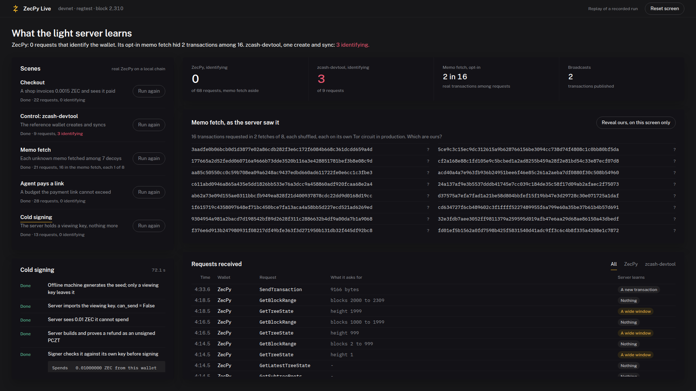

# ZecPy Live

A local page that runs [ZecPy](https://github.com/xerodahdev/zecpy) through five scripted
scenes on a real regtest chain, and shows beside them every request the light server
receives, as it arrives. It is what the ZecPy demo video is recorded from.

**Try the recorded run in a browser: https://zecpy-live.pages.dev.** Press Run on a scene,
or Run all; it replays this page's recorded run with its original timing. To run every
scene live on your own chain, see [Run it](#run-it).



## What each scene shows

| Scene | What runs | What the server learns |
|---|---|---|
| Checkout | A shop wallet issues an invoice; a customer pays it; the payment confirms | Nothing identifying: compact blocks, aligned tree states, one broadcast |
| Control: zcash-devtool | The reference wallet on the same librustzcash crates creates and syncs, through its own proxy | Its exact birthday and its transparent addresses (3 identifying requests in the recorded run) |
| Memo fetch | Nine payments land in one block; `fetch_memos()` reads the shop's memos | Each real transaction requested among 7 decoys; a local-only toggle marks which were ours |
| Agent pays a link | An agent wallet reads a ZIP-321 link; `pay(max_zat=100_000)` is refused, `max_zat=200_000` pays | One broadcast; the invoice confirms on the shop's side |
| Cold signing | A watch-only server builds and proves a PCZT; an offline signer inspects and signs it | One broadcast; the server never held a spending key |

All of it is real ZecPy, real proofs and real blocks. Nothing on the page is mocked: the
replay file is a recorded run of the same scenes.

## Run it

Needs the SDK checkout next to this one (`../zec`, or set `ZEC_REPO`), with its devnet
running and ZecPy installed in the environment you use:

```bash
cd ../zec && devnet/up.sh "$(cat ~/.zecpy-dev/wallets/miner.addr)" && cd -
source ../zec/.venv/bin/activate          # has zecpy, grpcio and fastapi
uvicorn demo.server:app --port 8077
```

Open http://127.0.0.1:8077 and press Run on a scene. "Reset screen" clears the page between
takes; wallets made so far stay in `runs/`.

Without a chain, http://127.0.0.1:8077/?replay plays back the recorded run
(`?replay=instant` shows it at once, `&reveal` with the memo toggle on). Re-record it with
`python -m scripts.record`.

## Reading the page honestly

- **The audit sees content, not the network path.** The proxies sit on loopback, so these
  runs use no Tor. In production ZecPy reaches remote servers over Tor, and
  `fetch_memos()` refuses to run without it; the page says "on its own Tor circuit in
  production" for that reason.
- **The memo fetch is counted, not hidden.** The audit labels every `GetTransaction`
  identifying. The page shows ZecPy's default path and its opt-in memo fetch as separate
  figures, and labels each memo-fetch row "1 of 8, hidden".
- **Devnet is a local chain** (zebrad 7.0.0, lightwalletd 0.6.0, every upgrade active from
  block 1). No testnet or mainnet funds move.

## Tests

```bash
pytest -q        # runs every scene against devnet and checks its privacy claims
```
